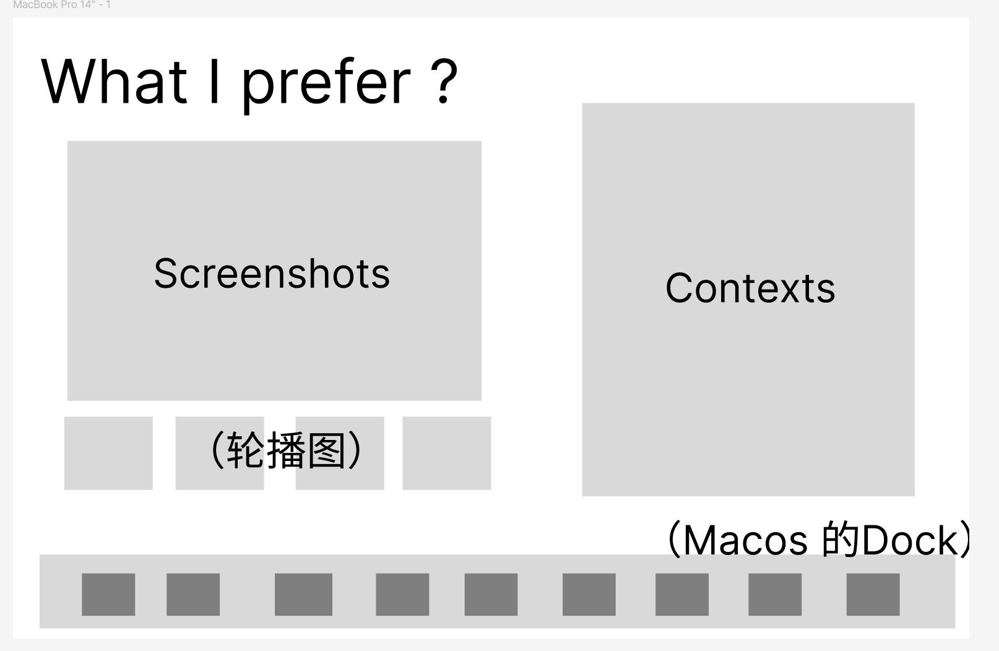
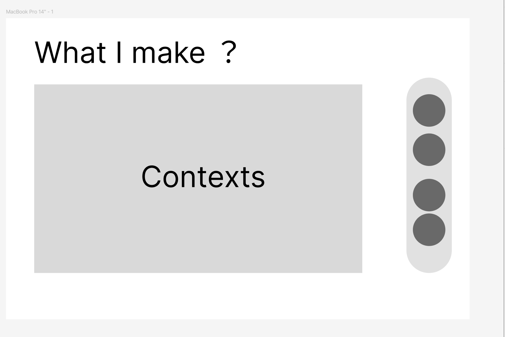
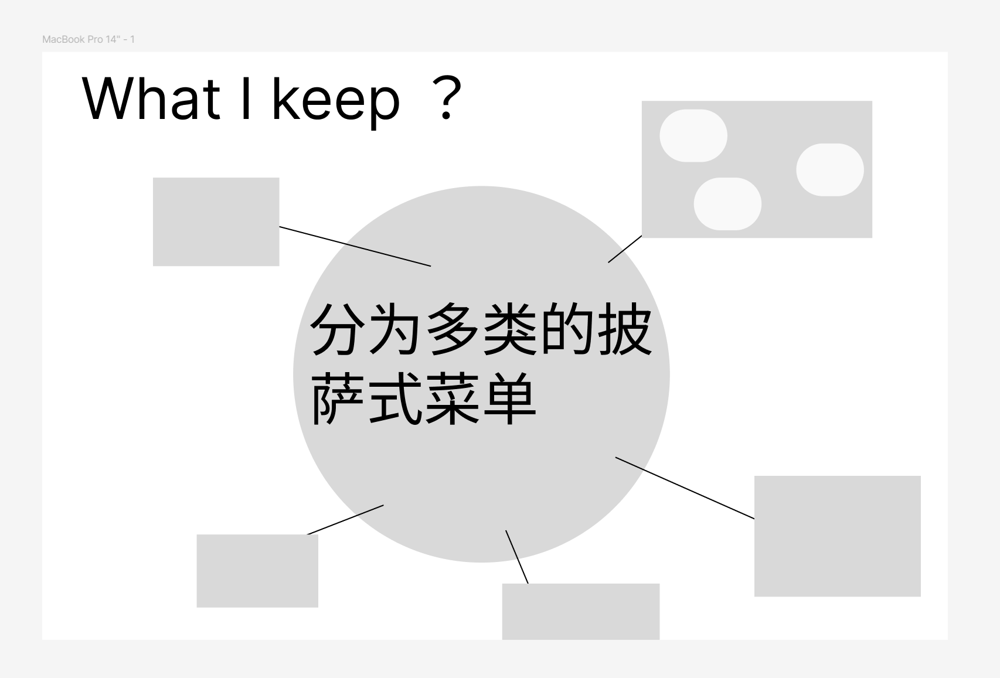
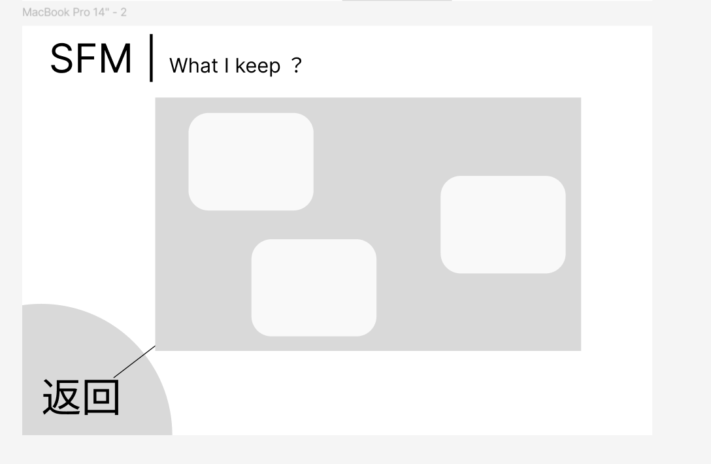

# Klasma 设计过程与评审记录

本文按需查阅，保存讨论经过、参考来源、候选值、被替代方案与未决问题。**当前有效设计以 [design.md](design.md) 为准**；本文中的历史表述和助手建议不能作为实现授权或已确认约束。常规开发无需读取全文。

## 当前评审边界

- 首选字体为 MiSans / Manrope（界面）、Noto Serif SC / Source Serif 4（长文）；A／A／D 是样张选择编号。
- 长文 18px / 手机 17px、中文行高约 1.8，控件 14–16px 是用户接受的排版起点；并非完整 token 定稿。
- 微冷白画布、稍亮表面、细边界、轻阴影、清透蓝交互，以及适度卡牌圆角、小圆角按钮、柔和阅读容器与 4px 间距基准已确认。
- 主题稿的具体色值、8 / 16 / 20px 圆角、阴影和动效参数仍是试排候选，未因用户认可方向自动确认。
- 手机原型的错位牌组、底部作品入口和资产两步预览等编排仍供评审。软件手机全屏阅读层已确认。
- 具体作品与各类资产详情内部按内容设计；SFM 追踪来源、运行边界和实现阶段未定。

## 讨论时间线

### 2026-10-28：从功能骨架转向设计先行

1. 用户提出，在继续推进公开内容浏览功能之前，先详细讨论 UI/UX，建立设计约束与风格要求；除文档外不落地代码，避免功能页完成后再整体重做。
2. 初步建议沿用暗色数字展柜和三个低饱和色块入口。用户明确修正：前台更偏向浅色单主题，清爽干净，同时 UX 要有张扬和飘逸感，不能过度克制或停留在简单色块入口。
3. 用户明确三张卡片的关系是“布局上对称，但摆放上张扬灵动”。由此区分稳定的整体结构与有表现力的卡片姿态。
4. 用户提出塔罗牌式的交互比喻：从三张牌里挑选一张，所选卡片放大展开，通过共享元素过渡进入下一个界面，挑选与展开都应有很强的动感、灵动感和灵活感。
5. 讨论将这一比喻拆为停留、挑选、确认、展开、返回的连续流程，并明确卡片与集合页共享标题、色彩和关键视觉身份。
6. 用户确认采用“现代解释”：保留收藏牌的形态、层次与选牌体验，不默认引入传统塔罗的装饰体系。该方向成为后续首页与集合页共同设计的基础。

### 2026-10-28：引入 Refactoring UI 质量约束

用户指定引入 `jaywilburn/refactoring-ui-skill`，安装到项目内 `.agents/skills/refactoring-ui/`，尤其用于后续间距、字号和设计 token 的讨论与确定。它补充设计执行质量，不替代已经确认的项目个性。根目录 `AGENTS.md` 明确后续 UI 工作需要读取该 skill 与本文档。

### 2026-10-29：确定三张牌的素材与表达方式

用户认可“图形与排版作为骨架，真实内容素材局部嵌入”的方向，并进一步提出：三张牌均使用较透明的素材背景；工具软件牌用软件 logo 墙的横向瀑布流，作品牌用界面截图与 logo 背景墙，工程资产牌用 SFM 代码、蓝图结构和 3D 图等素材。用户随后纠正“简介”的说法，明确前景为简洁的中英文标题与图形，不另加简介，并说明工程资产指长期使用并沉淀下来的东西。第三张牌的英文最初提议为 What I settle，讨论后用户确认使用 What I keep；三张牌的英文标题形成 use、make、keep 的对应关系。透明背景的具体材质、中英文主次、构图细节和持续动效仍保留为后续讨论项。

### 2026-10-29：集合页转向个人展示与定制编排

助手曾建议统一页头、搜索筛选与浏览区域。用户明确修正：三个集合应避免或尽可能减少筛选、搜索、高度一致的列表与高密度信息；站点不以服务他人为主要目的，内容顺序和布局应体现个人偏好、巧思与定制表达。本轮将这一点记录为集合页设计约束，具体版式继续讨论，未将助手此前的通用浏览方案视为用户确认。

### 2026-10-29：软件区从使用清单转向偏好与欣赏

用户将软件区的表达由 What I use 调整为 What I prefer，明确希望分享相对小众、好用且值得学习的软件工具，而非个人常用软件导航。用户以正在使用的 Windows 软件 Mole 为例，希望能结合作者的推特内容讲述其精致之处。本轮确认定位与标题变化，具体呈现方式继续讨论。

### 2026-10-29：以草图确定软件区的 Dock 与展台结构

用户提供草图，明确底部 Dock 切换不同软件，常见内容布局为左侧截图与轮播、右侧文字讲述，并允许不同类型软件采用各自编排。软件之间的切换借鉴 macOS 的收起与展开动效。本轮将草图保存在 docs/design-assets/ 中作为结构参考，取代此前助手提出但未确认的连续长页方案。用户随后纠正整页延伸的建议：截图区域保持固定，最初决定右侧文案超出时独立滚动。**这一历史方案已被后续「固定高度预览 + 阅读弹窗」的决策取代**；文案通常不会太长。具体视觉数值、形变程度仍待确定。

### 2026-10-29：作品区以强交互展示为重心

用户说明现有作品主要为软件，数量与成熟度有限，未来可能尝试嵌入式和硬件。针对助手提出的创作手记式页面，用户明确更偏好强交互的作品集：突出特点与下载等入口，更多介绍仅作扩展。当软件功能不便直接交互时，交互可以作用于展示过程。本轮确认这一重心，具体页面编排与交互方式仍待讨论。

### 2026-10-29：作品区先固定外层，内部按作品定制

用户进一步明确：作品不会很多，各作品页面通用性不高，前期无法固定全部 UI/UX。用户以草图提出右侧悬浮层竖排作品 logo、左侧主内容上下滑动过渡的布局方向。本轮保存草图并记录外层结构，不再要求先为每件作品确定内部展示方案；具体内部交互随作品特点设计。

### 2026-10-29：工程资产采用分类运镜、场景分布与遮罩详情

用户明确工程资产侧重直观与清晰，收录偏好包括机械动力、mek 等 mod 的多方块蓝图，以及 SFM 代码和对应产线的 3D 结构，并希望追踪可视化 SFM 的执行流程。用户提供全局与分类场景两张草图：全局采用大的披萨式分类菜单，场景以产线或结构等图像分布条目，点击条目通过遮罩弹窗查看详情；分类视图按原分类方位保留角落返回入口。用户随后修正进入方式：悬停只显示缩略图气泡，点击后才运镜进入，并可使用共享元素过渡。详情内部按类型另行设计，本轮只记录外层空间与导航关系，不承诺具体技术实现或首版范围。

### 2026-10-29：五视图原型与文档整理

用户要求以简洁文案和样式制作布局 mockup。独立原型保存在 `docs/mockups/`，包含首页收藏牌、软件、作品、工程资产全局与分类场景五个视图，并以占位弹窗表达资产详情容器。用户初步认可布局，随后要求整理工作区、更新文档并提交推送。该认可用于继续设计，不等同于所有视觉数值、动效细节或移动端方案定稿。

原型入口、交互说明与限制见 [原型说明](mockups/README.md)。用户草图保存在 `docs/design-assets/`，浏览器日志与截图输出不进入版本控制；正式页面、数据和部署配置未因原型改变。

首次评审时的原型尚未包含后续的首页个人身份与释义、软件全文阅读层、集合页胶囊导航与标题滚轮；这些差异已在后续原型同步中补齐，见下方记录。原型顶部评审导航仍不作为正式导航，移动端候选布局不视为定稿。

### 2026-10-29：软件区改为固定预览与阅读全文

用户进一步调整软件展台：右侧文案区不再独立滚动，而是使用固定高度预览；超出时出现展开按钮，以大遮罩弹窗浏览可滚动全文。移动端直接复用两级阅读逻辑，以全屏阅读层取代桌面弹窗。展开、关闭、过渡、溢出判定和长文录入方式待进一步验证。

### 2026-10-29：首页加入个人身份与站名释义

用户指出首页牌阵上方有较多空间，不希望套用商业 Landing Page 的品牌宣传语。确认加入个人头像、名称、签名、社交链接和 Blog / Weekly 入口，把 Klasma 作为个人数字空间的总入口。同时必须向初访者说明「Klasma」的希腊语碎片含义和站内具体收藏内容；感性签名与实际用途说明分层呈现。个人区域不能挤占三张收藏牌的主体地位，最终排版和措辞继续设计。

### 2026-10-29：开始单独处理移动端适配

用户发现既有草图主要为桌面宽屏布局，需要专门考虑手机端。确认响应式不仅是尺寸缩放，也包含输入方式、滚动和展开方式的调整；各板块的具体手机编排先列为候选方案，待手机草图与原型验证，不视作定稿。

### 2026-10-29：集合页全局导航与标题滚轮

用户提出借鉴 Mole 顶部的滑块式导航，解决从一个集合直接切换另一个集合的问题。讨论后选择：首页仍由三张收藏牌负责导航，不放完整胶囊；进入集合页后，在标题右侧配置胶囊导航，并使用 Home 图标 + Prefer / Make / Keep 三个文字项。三个集合的大标题保持 `What I` 不变，第三词像密码锁一样沿竖向滚动，与导航滑块及集合内容联动。进一步修正：**Home 使用独立的首页图标，不使用个人头像，不实施头像跨越页面到胶囊的共享元素转场**；原先提出的头像 Morph 方案作废。具体动画参数与小屏幕形态仍待原型确认。

### 2026-10-29：同步新决策并补充手机原型

用户要求将新增设计决策更新到 mockup，并提供常见手机尺寸的完整原型。现有五视图同步首页个人身份与站名释义、集合胶囊与标题第三词滚轮、固定文案预览与全文阅读层。新增 `docs/mockups/mobile.html`，通过同一份响应式原型展示五个主视图及两个展开状态，提供 360、375、390、430 宽度与 320 窄屏的视口样本。

手机候选采用竖向错位牌组、标题上方胶囊、底部作品选择器、分类点击预览后再进入的两步操作，以及全屏软件阅读层。这些是供用户继续评审的实现选择，不将此前开放的手机布局自动定稿。具体视觉语言与 Design Tokens 尚待讨论，现有数值继续作为临时原型值；正式应用未接入原型。

### 2026-10-29：确认材质、强调色与字体分工

用户选择偏现代软件界面的光滑、精密质感，收藏牌保留轻微厚度与抬起感；交互强调色选择清透蓝，具体色值与状态色阶尚未确定。字体不统一采用无衬线：界面文字使用无衬线，软件与作品中内容较多的详细介绍允许采用衬线，形成独立的阅读排版。标题选择稍厚实、轮廓鲜明的方向，正文保持舒适阅读。具体字体家族、字重数值、字号与行高待后续样张验证。

### 2026-10-29：以 MiSans 为首选制作同素材字体对照

用户认为过于常见的黑体容易显得平庸，希望认真斟酌字体，认可 MiSans 作为中文界面候选，并要求同一份素材制作多组对照后选择。新增独立的 `docs/mockups/typography.html`：中文界面固定 MiSans，分别比较 Manrope / Plus Jakarta Sans / Outfit 的英文界面、Source Serif 4 / Literata / Newsreader 的英文阅读，以及 Noto Serif SC / 朱雀仿宋的中文长文。提供组合、隐藏字体名称与窄屏样张，字体加载状态须明确，避免根据替代字体作判断。

本轮仅生成评审样张；MiSans 是首选候选，其余字体及组合均未定稿。具体来源、许可文本获取方式与本地缓存边界见 [字体来源说明](mockups/typography-SOURCES.md)。正式应用与既有布局原型未套用字体候选。

### 2026-10-29：字体组合选择 A／A／D

用户评审同素材样张后认可 A／A／D，记录为当前首选组合：中文界面 MiSans、英文界面 Manrope，中文长文 Noto Serif SC、英文长文 Source Serif 4。此选择确认字体搭配方向，不代表样张中的字号、字重、行高、字距与间距已定稿；后续基于这组字体确定排版尺度。其他候选保留作对照，正式应用暂不接入。

### 2026-10-29：接受排版、表面与圆角间距方向

用户在 A／A／D 字体选择后，同意以桌面长文 18px、手机 17px、中文行高约 1.8、导航按钮 14–16px 继续试排，标题按可用宽度调整，混排允许光学校准。随后接受接近中性的微冷白画布、稍亮表面、细边界与轻阴影，清透蓝集中用于交互反馈。

再确认圆角性格：收藏牌适度圆角，保持修长利落；阅读层与弹窗稍柔和；按钮小圆角，胶囊主要用于集合导航。间距采用 4px 基础阶梯，内部紧凑、主要展示区域舒展。具体数值尚需评审。

### 2026-10-29：建立持续设计主题稿

用户要求每次确定设计点，都反馈到单独的 HTML 主题图稿。新增 [主题稿](mockups/theme.html)，汇集收藏牌、阅读排版、色板、控件状态、圆角与间距，并适配手机宽度；该页演示视觉效果，集合选择仅切换选中状态，不是完整功能页面。已完成静态、字体资源与候选颜色对比度检查，未执行浏览器自动化或截图验证。

### 2026-10-29：拆分有效规范与过程，补充目录索引

用户要求 `design.md` 只记录已确定设计点与约束，详细确定过程迁入独立文档，减少后续 agent 的上下文负担。此次重整将有效规范精简留在 `design.md`，讨论时间线与旧版讨论材料保存在本文，并在 `AGENTS.md` 建立实际目录和按任务读取的索引。后续确认新设计时更新有效规范与主题稿，讨论依据、试排值与未决问题只进入本文。

### 2026-10-29：确定透明材质的范围与层次

用户接受材质分配：收藏牌保留半透明素材层次且保证文字清晰；集合胶囊、Dock、作品切换器接近实色、带轻微悬浮感；阅读和资产详情为实色表面；遮罩以中性灰弱化背景。背景模糊仅在悬浮导航压住复杂内容时少量使用，不扩展为全站磨砂玻璃。

主题稿同步增加材质并排对照，并让顶部胶囊体现接近实色的浅色表面。试排透明度为牌面 64%、悬浮表面 96%、遮罩 28%，阅读表面完全不透明；这些参数仍为候选。对照中的导航只展示外观，点击主样张的「阅读全文」可查看实际阅读层与遮罩。

### 2026-10-29：确认动效节奏与回弹边界

用户接受按钮短促、按下轻微收紧，Dock 与作品切换迅速且连贯，抽牌、展开、场景运镜舒展且具有加速与落定的动效方向。回弹仅在抽牌、抬起等空间动作中少量使用，文字与阅读层平稳落定。

主题稿加入可重播的三类节奏样张及「减少动态」开关；遵循系统 reduced motion，连续触发时取消旧动画并从当前外观接续。演示时长先取 140 / 280 / 560ms，仅为感受节奏的候选，不是用户确认的最终 token；几何样张不代表完整 Dock 收拢、共享元素转场或场景运镜已实现。

### 2026-10-29：统一图标语言与图标按钮

用户接受统一线性控件图标、保留软件与作品原生 logo、工程资产使用真实结构与蓝图的方向，并明确多数能由图标表意的按钮可直接使用图标，图标必须来自统一图标库。

本轮选择 Lucide 作为主题稿统一图标来源，保存固定上游提交的 house、arrow-left、x、arrow-up-right、rotate-ccw 子集到 `mockups/icons/lucide/`，来源、散列与许可一并保存；正式应用依赖未改变，未来实现时可按架构选择相应包。图标库选型是本轮执行选择，不另推导为用户确认的描边或尺寸参数。

主题稿增加图标操作区，Home、关闭、重播使用仅图标控件，保留可访问名称和可在悬停 / 键盘聚焦时显示、Escape 隐藏的提示。样张图标先试 20px、2px 描边，点击区域 44px；这些视觉参数仍为候选。含义不明确的阅读全文等操作保留文字，防止将所有按钮机械替换。

### 2026-10-29：首页右上说明词与集合导航建立共享元素关系

用户进一步调整首页个人身份区的构图：不将 GitHub、Blog、Weekly 等链接全部移至右上，以免左侧身份区变得单薄；左侧继续承载头像、名称、签名和主要链接，右上用「个人数字碎片库」与 `What I prefer · make · keep` 作轻量空间注释。下方的 `Klasma / κλάσμα` 释义与收藏内容说明继续负责解释名称和用途。

三个英文词在首页是说明文字，不是可点击导航；从任意收藏牌进入集合后，`prefer / make / keep` 分别共享元素过渡到胶囊中的三个导航词项，辅助文案与分隔点退场，胶囊表面、选中状态和独立 Home 图标出现。返回首页时可反向重组。**这与收藏牌展开到左侧集合大标题是两条独立路径**；Home 不使用头像，也不实施头像到图标的共享元素过渡。

该决策已加入有效设计约束。主题稿新增独立的交互样张，只验证右上三个词与胶囊之间的关系；完整首页布局、卡片展开、浏览器历史、窄屏与 reduced motion 仍需结合布局原型评审。共享元素不应成为导航的前置条件。

### 2026-10-29：将新决策同步至完整桌面与手机原型

合并 PR #3 后，按用户要求将左侧身份与链接、右上空间说明，以及说明词到集合胶囊的独立共享元素路径同步至完整布局原型。返回首页可反向重组，并清理再次选牌时遗留的共享元素名；浏览器历史与直达保持静态正确状态，窄屏说明词取消长距离飞行，键盘与 reduced motion 沿用直接切换。

完整原型同时应用已选字体组合与主题稿的材质、交互色和圆角候选，Home、关闭和场景返回共用 Lucide；字体准备脚本扩充完整原型文案覆盖。手机评审入口复用同一源文件，未另建一套页面。本轮不增加新的设计决策，具体数值仍待评审，不修改正式应用；仅进行静态与独立逻辑检查，未执行浏览器自动化或截图验证。

### 2026-10-29：从模拟验证转入正式实施，调整内容来源

用户评审现有主题稿与布局 Mockup 后整体满意，决定结束「必须先把所有 UI/UX 讨论完才能写正式前台」的阶段，开始将设计接入真实 React 页面；具体视觉数值仍可在开发中调整。

同时重新审视统一 CMS 的成本：作品区数量少、每件作品都需要高度定制的展示和交互，将通用编辑器扩展到可配置这些页面的成本大于收益。用户确认 Projects 改为前端静态托管与专属组件，不再把项目录入作为后端需求；Tools 与 Library 由于数量及字段共性，继续保留后台 GUI 与 D1 / R2。后端已有 `projects` 资源类型暂不做破坏性删除，先区分新内容的唯一来源，再检查历史数据。

后续具体目录、路由库、清理旧 API 的时机、是否为个别项目添加专属后端，以及先实施哪个真实作品，属于实施建议和待决策项，不自动视作已完成。

## 旧版讨论材料归档

以下保留拆分前的细节、来源、草图引用和候选方案，以便追溯，不再维护其章节号或把它当作当前规范。其中「当前」「待定」等词均指记录当时；包括已被后续决策替代的表述。请结合上方时间线与当前 `design.md` 判断。

# Klasma 设计需求

## 1. 设计目标

Klasma 的公开前台采用浅色单主题，以清爽、干净的画布承载有张力的构图。它需要轻松、张扬、飘逸，有明确的个人选择感；内容数量可以少，但每一项都应显得被认真保留。信息层级保持清楚，视觉与交互不必过度克制。

在继续补全公开内容浏览功能之前，先确定首页与集合页共同的设计约束、空间关系和动效逻辑，再围绕它们完善功能，减少先写完页面再整体改造的返工。当前允许通过独立布局交互原型评审设计，不将原型接入正式应用。

## 2. 已确认的体验方向

- 首页以三个内容板块建立入口：Tools、Projects、Library；同时呈现创作者身份，使访客理解 Klasma 是谁的收藏空间。首页三张牌就是主导航，**完整的全局胶囊导航仅在进入集合页后显示**。
- 前台采用浅色单主题；此前实现的暗色页面仅为功能骨架，不作为后续视觉基准。
- 首页三张入口卡片采用“现代收藏牌”的解释：借鉴塔罗牌的竖向形态、挑选仪式和抽牌动作，不直接采用神秘学符号、传统塔罗插画或金边装饰。
- 三张牌布局上对称、地位平等、整体平衡；摆放上允许错位、倾斜、高低差和适度重叠，形成舒展、张扬、灵动的牌阵。
- 卡片有明确边界与层次，内部通过排版、专属图形或媒体表达板块身份，不能只替换颜色和标题。
- 卡片式内容组织可以保留，但避免模板化的卡片网格和过度规整的页面结构。
- 公开前台优先体现策展、收藏和个人判断，而非资源数量统计。
- 资源详情页应能承载个人说明、使用背景、兼容性信息、下载入口和关联内容。
- 卡片进入列表或详情时，未来可使用类似 PPT Morph 的空间连续转场。
- 交互气质参考 osu!lazer 的连续、灵动和有反馈感，但不直接复制其视觉风格。
- 动效服务于层级、方向和状态变化，不为展示技术而添加动画。
- 后台以效率和清晰为先，公开前台才是主要的设计实验场。

## 3. 信息与视觉层级

集合中的展示单元按内容需要表达名称、个人说明与关键视觉，不强制套用同一种资源卡片或固定字段组合。类型、状态、标签、平台、版本和文件数量等信息应在理解或使用该内容时出现，不要让所有元数据同时争夺注意力。

首页应让访客理解“这里保存的是创作者亲自筛选和使用过的东西”，而不是先看到一堆分类、图标或统计数字。个人推荐理由和使用语境比复制官方介绍更有辨识度。

### 首页：个人身份与 Klasma 的释义

这是 2026-10-29 新增的首页信息架构决策，不改变 3.1 节的三张收藏牌作为核心入口的设计。

已确认的内容与层级：

- 利用首页上方原有的可用空间，加入个人身份区域：头像、名称（会枝 / huizhiLLL）、简短签名、社交平台链接，以及个人站点链接（Blog、Weekly）。
- Klasma 是站点 / 收藏空间的名称，会枝是创作者；两者应在空间与文字上建立明确联系，避免访客把 Klasma 当作突然冒出的不明品牌，也避免个人介绍盖过站点主题。
- 在首页以简短的两层文案解释站名：一层说明 `Klasma / κλάσμα` 源自希腊语，有「碎片、片段」之意；另一层说明站内收藏「我欣赏的软件、亲手做的作品，以及值得保留和复用的工程资产」。
- 个人签名可以使用「拾起值得留下的碎片」一类更感性的表达，但**签名不能替代对网站实际内容的解释**；最终措辞尚未定稿。
- Blog 与 Weekly 是长期维护的内容空间，应作为清楚可辨的站点入口，与 GitHub、Bilibili 等社交平台入口一起把个人站点串联起来；不强制所有入口都只显示同等权重的图标。
- 首页不是商业产品 Landing Page，不采用夸张的营销主标题、CTA 与功能卖点陈列来解释自身；个人区域保持轻盈，三张收藏牌仍是视觉与交互主体。
- `What I prefer / What I make / What I keep` 中的「I」与上方个人身份形成呼应；个人身份负责交代「是谁」，收藏牌负责表达「欣赏、创造、保留了什么」。

当前可用于排版评审的**候选文案**，不是最终定稿：

> Klasma / κλάσμα · 源自希腊语，意为「碎片」。
>
> 这里收藏着我欣赏的软件、亲手做的作品，以及值得保留和复用的工程资产。

进一步的命名故事（包括后来发现的《约翰福音》相关语境）可以留在 About 或轻量注释中，不要求首屏一次性讲完。头像位置、文字比例、个人资料与牌阵的相对构图、链接呈现形式均尚待设计，不将本节当作具体 UI 模板。

### 3.1 首页牌面的内容方向

三张牌采用共同的牌面结构：低视觉权重的真实素材背景，加上简洁的中英文标题和辅助图形，不另加简介。背景表达收藏内容的质感，前景负责让访客快速理解入口含义。三张牌的身份与排版保持稳定，不随每次资源更新整体改变。

已确认的前景标题为“软件 / What I prefer”“作品 / What I make”“工程资产 / What I keep”。软件强调个人偏好与欣赏，工程资产强调长期使用后沉淀、选择保留下来的内容。此处英文短句承担牌面表达，不要求与内部集合名 Tools、Projects、Library 逐字对应。

| 板块 | 已确认的背景方向 | 表达重点 |
| --- | --- | --- |
| 工具软件 / Tools | 软件 logo 墙，以横向瀑布流的方式组织。 | 偏好与欣赏的软件、工具与网站，侧重相对小众、好用且值得学习的作品。 |
| 作品 / Projects | 作品相关的软件界面截图与 logo 背景墙。 | 自己制作的项目与成果；素材选择需要让作品主体清楚可辨。 |
| 工程资产 / Library | SFM 代码、蓝图结构、3D 图等工程素材。 | 能够保存、理解与复用的工程内容；视觉不将该板块永久限定为 Minecraft。 |

用户提出背景采用较透明的一层。当前按“背景素材淡化、保留层次与可辨识度”理解；是否采用透光材质、模糊效果及具体透明度尚未确定。

以下是后续排版与素材处理的建议，尚未作为最终视觉定稿：

- 共同使用“背景素材 → 局部遮罩或留白 → 中英文标题 → 方向图形”的层级，避免将整张牌连同文字一起降低透明度。
- 中文承担入口识别，英文短句表达该集合与创作者的关系。中英文的大小与主次关系继续讨论。
- 素材可保留局部原色，通过统一的亮度、密度和遮罩处理融入浅色画布，不预设全部灰化或统一染色。
- 背景中的 logo、截图与代码作为整张牌的视觉素材，不分别提供点击入口；整张牌进入对应集合。
- 作品牌优先使用自己的项目界面与标识。若出现制作工具的 logo，应处于辅助位置，避免与工具软件牌混淆。
- 工程资产牌以一个主要结构图或 3D 主体建立重心，代码与其他图示辅助，不将所有素材等量平铺。
- “横向瀑布流”先确定为构图方向，是否持续滚动另行决定；牌面背景动效不能与选牌、抽牌和展开同时争夺注意力。
- 素材缺失或加载失败时，中英文标题、图形与牌面边界仍能完整表达入口；背景不承担必要文字信息。

### 3.2 集合页的个人编排原则

本节的集合页指首页三张牌展开后的页面，不等同于单条资源详情。用户明确：网站以个人使用和表达为先，不以服务其他访客的检索效率为主要目标；三个集合应体现个人偏好、巧思和独特的展示编排。

已确认的约束：

- 避免或尽可能减少搜索、筛选、高度一致的列表和高密度信息；不将搜索框、筛选栏和排序控件作为集合页的默认骨架。
- 展示顺序可以表达创作者的偏好、内容之间的关系或个人叙述，不要求默认按时间、热度或名称排列。
- 三个集合允许采用各自的展示节奏与布局，同一集合内部也允许主次、尺寸、分组和版式变化；不强制所有条目获得相同的空间。
- 一致性主要体现在字体、间距、交互反馈、导航和返回体验，不要求三页复用相同的列表结构。
- 个性化编排仍需保留可读性、可操作的链接与附件入口，以及小屏幕上明确的阅读顺序；必要的版本与兼容性信息在使用位置呈现。
- 既有搜索、筛选 API 或功能骨架不构成前台必须展示对应控件的设计依据。当前只修订文档，不删除既有能力或改变数据结构。

前一轮提出的“共同页头 + 搜索筛选 + 统一浏览区”不作为定稿。集合间切换入口与标题联动已由下文 3.2.1、3.2.2 节确定；页头具体尺度与各集合内部空间编排仍需结合真实或代表性内容继续设计。

#### 3.2.1 集合页全局胶囊导航

2026-10-29 后续设计已确认的结构与行为：

- **首页不放完整的全局胶囊导航**。首页以个人身份介绍与三张收藏牌完成主要入口，避免重复导航和商业 Landing Page 式的常驻 Tab。
- **进入任意集合页后，右上角出现一条横向长胶囊导航**，利用集合页大标题右侧的空白，与左上角的大标题形成相对稳定的左右关系。
- 胶囊按顺序放置四个入口：**独立的 Home 图标**、`Prefer`、`Make`、`Keep`。Home 图标明确用于返回首页，其余三个词分别对应 Tools、Projects、Library。
- 当前集合的胶囊项带有清晰的选中状态；在集合之间切换时，高亮背景应连续滑动，胶囊本身尽量保持位置稳定，不因页面内容不同而整体跳动。
- **Home 图标不是创作者头像**，两者既不共用视觉实体，也**不做头像到 Home 图标的跨页面共享元素过渡**。首页头像保留在个人身份区域；此前讨论过的「头像飞到右上胶囊」方案已明确取消，避免跨度太长且与首页抽牌动画抢占注意力。
- 点击 Home 返回首页后胶囊退出，恢复个人资料与三张牌；从首页点击收藏牌进入对应集合时，胶囊出现，但不需要把头像当成导航动画的一部分。
- 胶囊负责**三个集合的全局切换**；软件区底部 Dock 负责软件切换，作品区右侧 Logo 负责作品切换，工程资产径向菜单负责分类导航。各自保留独立的局部操作语义，不用统一成同一种导航组件。
- Home 图标应有可理解的图形、悬停提示与可访问名称（例如「返回首页」）；各集合直达链接应可独立打开，不能依赖先从首页完成动画。

具体宽度、圆角、材料、边距、入场形式与响应式折叠方式尚未定稿。尤其在小屏幕，胶囊不必机械保持桌面尺寸与右对齐位置，但应保留同样的四个导航目标。

#### 3.2.2 三集合共用的标题滚轮

- 三个集合页左上角共用主标题结构 **`What I [prefer / make / keep]`**：`What I` 是稳定不动的文字基座，第三个单词形成竖向的「密码锁 / 单词滚轮」。
- 切换集合时，当前单词沿垂直方向滚出，目标单词从相应方向滚入；前后候选词可在上方与下方弱化显示，用裁切和渐隐强化连续滚动感，而不是直接替换三段文字。
- 滚轮、右上胶囊选中滑块和下方集合内容**对应同一次导航状态变化**，不能各自异步切换产生前后不一致。顶部导航稳定，标题第三词运动，集合主内容以各自适合的方式过渡。
- 从 `Prefer → Make → Keep` 与逆向切换时，运动方向应有逻辑；任意两个集合可直接切换，不强制播放中间集合的完整页面。跨越末端的路径、循环滚动与否、精确缓动等留给可操作原型验证。
- 进入集合时可由原来收藏牌的身份信息衔接至集合标题，但不必将头像或首页个人资料纳入共享元素路径。
- 切换过程中仍须保持标题语义可读取：辅助词不被当成多个有效标题；无动效模式直接显示目标完整标题。

**全局状态与导航约束：** 浏览器后退/前进、刷新和直接访问 URL 都需显示正确选中项与标题；快速重复点击允许中断并以最后一次选中为准；键盘焦点、触屏操作、reduced motion 和返回路径均保持明确。

### 3.3 软件集合：What I prefer

用户确认将软件牌的英文由 What I use 调整为 What I prefer。软件区的重心是偏好、欣赏与分享：介绍那些不那么知名、相对小众，但很好用、有精致之处且值得学习的软件和工具。日常使用经历可以成为介绍的依据，但不以常用软件导航或工作台清单作为该集合的组织主线。

内容选择与表达应体现：

- 为什么欣赏这个软件，以及哪些具体细节值得讲述；不以功能列表和下载按钮替代个人判断。
- 为截图、交互演示、设计细节、使用感受及开发故事保留足够的叙述空间，按实际内容选用，不要求每篇填满相同栏目。
- 可以结合作者公开的开发过程、设计取舍或技术实践展开介绍；区分本人的体验与判断、作者原述和第三方信息，引用标注来源。
- 不将“偏好”自动理解成同类产品排名，不要求每篇提供竞品对比或证明某个软件最好。

用户以正在使用的 Windows 软件 Mole 作为代表性内容，认为其精致且值得结合作者的推特内容展开介绍。用户随后明确产品官网为 https://mole.fit/zh/windows，作者为 tw93；作者公开的开发过程是用户认为值得学习的重要内容。它是后续讨论版式的候选样本，尚未确定具体文章、展示顺序与最终编排；拟引用的具体推文和用户最想讲述的细节仍待选择。

样本参考来源：

- [Mole Windows 官网](https://mole.fit/zh/windows)：用于核对产品与界面内容。
- [作者 X 主页](https://x.com/HiTw93)：由官网关联，具体推文按实际引用另行记录，不能将官网或博客内容标作推文。
- [作者博客：在快 AI 时代，如何做一款慢产品？](https://tw93.fun/2026-10-26/mole-product.html)：包含开发、图标、文案及测试等过程的第一方说明，涉及不同平台时应分别核对，不将 Mac 细节直接视为 Windows 行为。

待讨论的叙述建议：软件介绍允许围绕一个具体细节展开“观察与欣赏 → 截图或演示 → 作者的取舍与来源 → 自己学到什么”，不将其强制为固定文章模板。作者的公开记录用于支持个人叙述，不自动批量转载，也不代替用户本人的判断。

用户随后提供草图，确定软件区采用底部 Dock 切换、上方展示当前软件的结构，详见 3.4。此前建议的连续长页、先看片段再进入单篇的方式不作为当前主结构。独立链接如何定位当前软件，以及是否需要额外的长文阅读形式，后续再确定。

### 3.4 软件区：Dock 切换与单款软件展台

用户于 2026-10-29 提供的布局草图：

已确认的结构：

- 底部 Dock 承担软件之间的内容切换，上方一次展示当前选中的软件；Dock 中的条目对应本站的软件介绍，不启动或下载软件。
- 通常采用左侧软件截图与轮播区域、右侧文字讲述区域。图像承载具体界面与细节，文字承载偏好、欣赏和分享。
- 截图区域下方可通过缩略图切换同一款软件的媒体；缩略图切换与底部 Dock 切换软件属于两个不同层级。
- 桌面端截图与轮播区域保持固定。**右侧文案预览区也采用固定可用高度，不设置内部滚动条**；内容未超出时直接完整展示，超出时显示明确的「阅读全文」入口，由阅读弹窗承载全文。
- 文案增长不撑长展台或将 Dock 推出视野；预览区可有渐隐提示，但完整内容必须可通过阅读弹窗获得，不缩小字号硬塞，也不把预览区的溢出正文当作可直接滚动内容。
- 不同软件及软件类型允许拥有各自的内容编排，左右布局是常见结构，不是所有介绍必须填满的固定模板。
- 软件之间切换时，借鉴 macOS 窗口向 Dock 收起、从 Dock 展开的空间动效，保持软件图标与其展示内容的对应关系。
- 草图用于表达结构与关系，不将灰色占位块、满宽 Dock 底板、字体、标题问号、固定尺寸或区域比例直接视为视觉定稿。标题文案仍为 What I prefer。

新增的两级阅读结构（已确认交互意图）：

- 默认展台是「快速了解」状态：媒体与文案预览保持稳定，文案没有溢出时不必显示展开按钮；内容溢出时提供清楚的阅读全文入口。
- 点击后展开较大的遮罩阅读弹窗，桌面端在更宽敞的容器中滚动阅读全文；移动端使用全屏阅读层。阅读层可滚动，背后的展台不跟着滚动。
- 关闭阅读层返回同一软件展台，不丢失 Dock 当前软件与媒体选择；可考虑通过共享元素过渡，让预览区自然扩展为阅读层，关闭时反向收回。
- 阅读层须支持明显的关闭入口、Escape、焦点限制与返回、背景防误操作；触控屏应有明确的返回方式，遵循 reduced motion。
- 对较长文案，可考虑未来分别维护「展台摘要」与「完整文章」，减少机械截断一句话的情况；是否增加独立录入字段尚未确定，初期可基于内容溢出判断。

以下是待讨论的交互与排版建议，尚未全部定稿：

- 集合标题、返回入口和 Dock 保持稳定，当前软件的媒体与文字作为一个展示整体参与收起和展开，避免只替换截图、文字突变。
- 从 A 切换到 B 时，A 的展示内容向 A 图标位置收拢，B 的内容从 B 图标位置舒展进入展台；两者可以适度交错，避免先完全退场再等待新内容出现。
- 保留收拢、牵引与展开的方向感，形变强度与技术方案后续讨论，不预先承诺逐像素复刻系统动效。文字在剧烈形变阶段可短暂淡出，展开接近稳定时恢复清晰。
- 快速连续切换以最后一次选择为准，过渡可打断，不排队播放。媒体加载慢或失败时仍能显示软件身份与文字，避免空白等待。
- Dock 的排列顺序体现个人偏好；当前选择有持续可辨的状态，悬停或键盘聚焦时可显示软件名称。悬停放大幅度、底板材质和图标风格待定。
- 轮播以手动切换为主，提供清楚的当前项与可操作入口；是否需要图文联动另行讨论，不默认自动播放或强制同步右侧全文。
- 小屏幕可转为媒体在上、文案预览在下，Dock 保留可触达的软件切换能力；图标过多时允许横向浏览，不无限缩小图标。完整阅读使用移动端全屏阅读层，避免小屏幕嵌套滚动与触摸手势冲突。
- 键盘可选择软件与媒体，焦点在切换后保持可追踪；reduced motion 下用简短淡入淡出或直接替换，保留选中状态与相同内容。

这些设计首先约束软件区；作品与工程资产是否采用 Dock 或同类切换方式尚未确认，不自动套用。

### 3.5 作品集合：What I make

用户明确作品区以强交互的展示过程、作品特点和下载等行动入口为重心。更多介绍文案作为可扩展内容提供，不占据主要展示空间。此前助手提出的纵向创作手记与较多过程叙述不作为该集合的主方案。

已确认的方向与背景：

- 现阶段作品数量有限，完成度较高的作品不多，主要为软件；未来可能扩展到嵌入式与硬件作品。布局不依赖大量成熟作品，也不限定为软件截图。
- 作品特点通过交互式展示突出，不能仅依靠长篇介绍或为静态图文增加装饰动画。
- 作品本身能够在网页中直接体验时，可以考虑真实体验；功能不方便移入网页时，允许设计具有参与感的展示过程，不要求复刻完整应用。
- 下载、体验、仓库等入口按项目实际情况提供，保持清楚可达，不以完成展示动画或阅读说明作为前提。
- 背景、开发过程、技术说明等长文作为可展开的补充，不成为页面的默认阅读主线。
- 软件区已经采用 Dock 与截图、文字展台；作品区当前采用右侧竖向作品入口与左侧定制展示的外层布局方向，具体见 3.6。

待讨论的设计建议：

- 采用以作品视觉为中心的互动展示区域，名称与一句特点建立身份，少量可操作的特点入口改变当前演示、视角或展示状态。
- 强交互需要与作品特点关联，例如切换前后状态、控制流程演示、展开结构或放大关键部位；每个作品只选择适合自己的方式，不要求所有项目具有相同交互。
- 软件可使用受控演示、局部界面或输入输出过程，硬件可使用实物影像、不同视角及结构展示；具体媒介按素材与收益决定，不预先引入 3D、WebGL 或大型依赖。
- 演示片段、交互示意与真实运行功能应能区分，不让观看者误以为网页执行了实际系统操作；演示不需要虚构运行结果或完成度。
- 作品切换、作品内部展示、扩展说明分别有清楚的层级。支持跳过或快速切换，不劫持滚动，也不让强交互妨碍触控、键盘或 reduced motion 使用。

前期只确定集合的外层布局与作品切换关系；每件作品的内部 UI/UX 随具体作品单独设计，不要求现在逐件定稿，也不以内部方案齐备作为继续其他板块设计的前提。

### 3.6 作品区：右侧悬浮入口与纵向切换

用户于 2026-10-29 提供的布局草图：

当前采用的外层结构方向：

- 作品数量预计不多，各作品展示页面的通用性有限，根据各自特点选择展示与交互方式；前期不固定统一的内部 UI/UX 模板。
- 页面右侧设置悬浮的作品切换区域，竖向排列各作品 logo，选择后切换左侧主内容。
- 左侧保留大面积的定制展示空间，一次以当前作品为主体。草图中的 Contexts 是内容区域占位，不代表这里以文字为主。
- 左侧主内容在作品切换时采用上下滑动过渡；右侧切换区域作为稳定的选择参照，不套用软件区向 Dock 收拢、展开的动效。
- 外层的定位、选择状态、返回路径及切换规则保持一致；内部排版、媒体、特点展示与交互按作品定制。
- 草图表达当前布局方向，不确定最终比例、尺寸、字体、悬浮层材质、圆角或 logo 形状。集合标题沿用 What I make，不因草图中的问号自动改动。

待细化的交互建议：

- 根据右侧作品顺序确定上下过渡方向，例如切到后项时当前内容向上离开、新内容从下方进入，切到前项时反向；直接跨项选择不必依次播放中间作品。
- 主内容过渡以一次作品切换为单位，避免内部元素无规则地分别进出；内部交互可以有自己的节奏。
- 右侧当前项持续可辨，悬停与键盘焦点可显示作品名称；支持直接选择，不要求只能依序浏览。
- “上下滑动”目前确定的是视觉过渡方向，不自动等同于全局接管滚轮或触摸手势。是否支持滑动切换、如何与作品内部滚动及拖拽共存，后续单独确定。
- 快速切换应可打断；触控、键盘、reduced motion 与小屏幕入口位置仍需设计，不机械照搬桌面侧栏。

本节仅记录外层布局与切换方向，具体项目的内容编排继续保持开放。

### 3.7 工程资产：What I keep

工程资产区以直观、清晰为侧重。用户当前的收录偏好包括机械动力、mek 等 mod 的多方块与蓝图资产，以及 SFM 代码和对应产线的 3D 空间结构。SFM 子项希望能够在代码执行过程中追踪并可视化流程；此处记录体验目标，运行环境、追踪数据来源、仿真或真实执行的边界与实现阶段尚待单独确认，不视为现有能力。

用户于 2026-10-29 提供的两层布局草图：

当前采用的浏览结构：

| 层级 | 内容与操作 |
| --- | --- |
| 全局视图 | 大的披萨式分类菜单，各分类占据明确方位，并具有可辨认的名称或视觉身份。 |
| 分类预览 | 悬停或聚焦某个分类时，出现带缩略图的小气泡，不直接进入场景。 |
| 分类场景 | 点击分类或其预览气泡后，镜头向对应方位平移、放大，并可通过缩略图与场景的共享元素过渡进入分类。条目以回忆场景般的空间分布呈现，图像来自实际产线、结构图或可代表内容的图标。 |
| 单项详情 | 点击具体条目，以遮罩弹窗展开详情。工程资产种类较多，本阶段不固定详情内部布局，按具体类别与内容另行设计。 |
| 返回全局 | 分类场景在对应方位保留返回入口；草图示例位于左下角，实际位置取决于该分类在披萨菜单中的方位。返回时镜头缩回全局视图。 |

- 分类导航、场景条目和详情是三个层级；分类场景沿用全局中的空间关系，不在进入分类后随机换位。
- 分类内条目通过真实视觉素材帮助识别，不强制排列成统一的资源卡片网格；场景中的分布与主次可以表达个人编排。
- 详情弹窗关闭后回到原分类场景，保留原来的视角与条目位置，不自动退回全局。
- 返回角落是全局空间关系的一部分，不将所有分类的返回入口一律固定为左下角。
- 草图表示空间关系，不固定分类数量、扇区等分方式、圆的完整露出范围、色值、尺寸及灰色占位块样式。集合标题仍为 What I keep，分类视图可同时表达当前分类身份。

待细化的交互建议：

- 悬停只显示缩略图气泡，不触发导航；气泡与分类之间应有可连续移动的指针路径，避免准备点击时气泡消失。点击后才触发运镜与共享元素过渡，进入分类后视图保持稳定。
- 分类场景中的条目位置与点击范围需清楚，图像配简短名称即可建立识别，避免只有气氛却无法判断内容。重叠、远近与留白不能遮挡必要入口。
- 返回入口保留来自全局的方位提示，同时有清楚的文字与足够的操作范围；边角造型不应把入口挤出可见区域。
- 触屏提供预览与明确进入入口，具体单次点击或两步操作待验证；键盘聚焦可预览、确认后进入。reduced motion 下直接切换或短暂淡入淡出，保留同样的分类与返回关系。
- 弹窗提供明确关闭入口、Escape 关闭和焦点管理；打开时避免背景误操作，关闭后焦点回到原条目。点击遮罩是否关闭以及稳定分享链接的行为后续确定。
- 分类与条目增多、小屏幕容纳方式及素材缺失状态后续设计，不通过无限缩小条目维持全景。

当前先确定外层导航与详情容器，具体分类边界、条目布局及各类详情仍保留开放；不预先指定 3D 渲染、代码解析或流程追踪的技术方案。

### 3.8 响应式设计：保持交互语义，而非缩小桌面稿

桌面 Mockup 的宽屏布局已形成，但**移动端尚未定稿**。以下区分确认的跨端原则与需要验证的布局候选，不把讨论中的设想自动当成正式决策。

已确认的原则：

- 维持相同内容、选择关系与导航路径，允许不同设备使用不同的空间编排和输入方式；响应式也包括交互模式的适配。
- 不直接等比例缩小桌面卡牌、侧边导航和径向场景；根据可用宽高与触摸范围重构布局，保留清晰阅读顺序。
- 动画延续空间连续性，但可调整运动距离、方向和幅度；触屏不依赖 hover，键盘导航和 reduced motion 保持可用。
- 考虑窄屏、触屏安全区域、软键盘、横竖屏变化、快速切换与直接访问深层 URL，避免多层滚动和手势争抢。
- 软件区两级阅读已确认：移动端可纵向组织截图与文案预览，阅读全文使用全屏阅读层。

尚待通过手机竖屏草图和可操作原型验证的候选：

- 首页三张收藏牌可由横向牌阵转为纵向错位牌组，或横向拨动、保留相邻牌可见的牌阵；不能让另外两张入口不可发现。
- 作品区右侧竖排 Logo 切换器可转为底部横向切换器；是否保留上下滑动的换场方向，以及与作品内部手势如何共存，仍需试验。
- 工程资产区可探索压缩的径向 / 半圆方向菜单或另一种保留方向坐标的移动布局；类别位置、运镜和返回关系仍需可理解，不能照搬 Kando 鼠标操作。
- 工程资产详情在小屏幕可采用 Bottom Sheet 或全屏详情；场景条目太多时需要额外的浏览和定位办法，而不是无限缩小。
- 可先绘制约 390 × 844 的手机竖屏结构草图，再检验平板 / 窄桌面过渡；此尺寸是验证样本，不是固定断点。

## 4. 动效要求

首页的核心体验是“从三张牌中挑选一张，选中的牌放大展开为下一个界面”。选牌、抽出和展开过程需要明显的动感、灵动感与灵活感；首页牌面与集合页必须一起设计，不能在独立页面完成后再补一段放大动画。

### 4.1 选牌与展开流程

| 状态 | 交互与空间关系 |
| --- | --- |
| 停留 | 三张牌形成平衡而舒展的牌阵，静止姿态本身具有表现力。 |
| 挑选 | 当前牌向前抬起、轻微放大并适度归正，相邻牌响应并让出空间，强调从一组牌中做选择。 |
| 确认 | 按下时短促收紧，选中的牌脱离牌阵、进入前景，其余两张向两侧退开。 |
| 展开 | 选中牌归正、放大，牌面延续为集合页容器；标题、编号、主色和关键图形沿明确路径进入新位置，资源内容随后出现。 |
| 返回 | 集合内容退场，页面收拢回原来的牌，另外两张恢复位置，回到熟悉的牌阵。 |

牌面元素到集合页的对应关系：

- 板块标题延续为页面主标题。
- 主色延续为页头或局部视觉区域。
- 编号和标记延续为集合身份信息。
- 关键图形或媒体延续为页头视觉主体。
- 卡片边缘随页面展开逐渐退出画面。
- 进入集合后，右上角的全局胶囊导航独立出现，**没有头像到 Home 图标的共享元素过渡**。

### 4.2 交互约束

- 快速切换选择时，动画从当前位置连续接续，允许打断、反向与取消，不重复播放完整入场动作。
- 灵动感主要来自抽牌层次、相邻牌让位和展开节奏，不依赖持续自动漂浮或强烈鼠标追踪晃动。
- 首先设计“首页牌 → 集合页”的完整共享元素路径，再延伸到资源详情。
- 直接访问集合或详情链接时正常展示页面，不强制补播首页选牌过程。
- 手机端减小倾斜与重叠，单次点击即可选中并进入，不要求先选牌再点击确认。
- 键盘操作需要清晰焦点和直接进入能力，不能依赖悬停；reduced motion 下保留同样的信息与导航能力。

- 首页板块卡片进入分类页时，背景、标题和关键视觉元素可以保持身份连续。
- 详情页展开、列表重排和筛选结果变化应有明确的空间关系。
- 页面切换应考虑用户当前焦点、滚动位置和返回路径。
- 动画需要支持 reduced motion，不能影响内容读取和基本操作。
- 动效节奏、缓动和层级应作为设计决策记录，而不是只由实现库默认决定。

### 4.3 集合之间的全局转场

从一个集合切换到另一个集合时，交互应当是一个协调的状态转变：

1. 用户点击右上胶囊的 `Prefer / Make / Keep`，选中滑块及时开始移动。
2. 左侧标题保持 `What I` 不动，只让第三个单词沿对应方向滚动。
3. 下方当前集合内容离场、目标集合内容进入；集合内部的 Dock、作品切换器、工程资产场景各自处理自身局部状态。
4. 顶部胶囊保持稳定；整个转场支持中断，目标状态与 URL 保持一致。

从集合点击 Home 时恢复首页三张牌和个人信息，胶囊退场；不强制每次都重播完整的选牌逆过程，是否利用收藏牌共享元素按具体导航路径判断。直接进入集合或不支持动画时应采用可靠的普通页面切换。

**原型重点：** 滑块位置与标题滚轮同步；集合间切换是否有方向感而不拖沓；从页面返回时是否清楚；连续点击、浏览器后退、视口变化和 reduced motion 是否都能回到稳定状态。技术实现不提前绑定某个特定动画库。

## 5. 录入体验

录入成本应足够低：标题、类型、链接或文件、简短说明即可先保存。详细介绍、封面、标签和兼容性信息允许后补。

不同类型使用同一套编辑器骨架，再根据类型显示差异字段。用户不需要为了保存一条小资源填写完整 CMS 表单。

## 6. Design Notebook

项目可以维护一份设计笔记，用于记录参考作品和决策：

- 哪个界面细节让人觉得舒服。
- 它解决了什么信息或交互问题。
- 这个做法是否适合 Klasma，适合的前提是什么。
- 实现后实际效果如何，是否需要调整。

设计笔记服务于长期迭代，不作为第一版上线阻塞项。

## 7. 当前不做的视觉承诺

浅色单主题、现代收藏牌、对称布局与灵动摆放、选牌展开的共享元素过渡已经确定。具体字体、色值、牌面比例、圆角、阴影、图形素材、倾斜幅度和动效时长仍需后续讨论，当前不指定数值。现有衬线大标题和三块低饱和色块不自动继承为最终设计。

## 9. 排版、间距与 token 的设计约束

规则来源：[项目内 Refactoring UI skill](../.agents/skills/refactoring-ui/SKILL.md)。本节是 Klasma 的适用解释；包含已确认方向与排版起点，候选数值需在实际布局中继续验证。

### 9.1 有限尺度与语义角色

- 间距使用统一的有限阶梯，4px 或 8px 基准及 skill 给出的序列仅作为候选。需要分别定义组件内部、关联内容、内容分组和页面区块的间距角色，避免逐处随意取值。
- 关联内容距离更近，独立分组距离更远；页面节奏允许随内容重要性变化，不要求每个区块等距。
- 字号先建立明确阶梯，再映射到牌面标题、集合标题、资源标题、正文、辅助说明和元数据。以字号、字重、颜色共同建立层级，避免只靠巨大标题和极小辅助字。
- 字重控制在少量角色中。中文正文按实际字体确定足够行高；中文标题不直接套用拉丁标题的负字距或紧行高。长文行宽同时验证中文与代码内容，不能只照搬英文字符数。
- 基础 token 表达数值尺度，语义 token 表达用途，组件 token 表达牌面或控件中的具体应用；仅为真实重复或角色差异引入 token，不扩建与当前需求无关的系统。
- 颜色按画布、表面、文字、边界、交互、板块身份等角色定义，并覆盖必要的 hover、pressed、focus、disabled 状态。色值格式在后续确定，不把 skill 的 HSL 示例视作强制要求。
- 圆角、阴影和层级使用有限档位。牌阵的投影用来表达抬起与抽出的空间关系，普通列表和后台无需继承同等视觉重量。
- 后续 token 文档应记录名称、用途、值、状态和响应式变化。光学微调若偏离尺度，需要注明具体原因，不能成为任意取值的惯例。

### 9.2 可读性与操作约束

- 普通文字对比度至少 4.5:1，大字和必要控件边界至少 3:1；不能仅靠颜色表示状态。
- 触控目标以至少 44 × 44px 为基线，保留可见的键盘焦点；小屏幕必须保持牌面标签和入口可操作。
- 依内容宽度确定响应式变化，手机保留牌组身份和一次点击进入能力，不机械缩小桌面牌阵。
- 加载、空结果、失败、未找到等状态也需要明确的信息层级和返回路径。

### 9.3 通用 skill 与项目个性的取舍

- Skill 反对模板化的三卡网格；Klasma 的三张牌对应三个明确内容板块，且承担选牌交互，这是用户确认的产品结构，予以保留。
- Skill 倾向轻微、短促的动效；Klasma 的抽牌与展开允许更强的空间表达。高频浏览操作保持快速，大转场需即时响应、可打断、可返回，并提供 reduced motion 体验。
- Skill 中的配色、字体、居中 CTA、组件布局与 500ms 上限等示例不直接作为项目定稿。后续依据实际阅读、交互节奏和用户确认来确定数值。
- 不直接复制 skill 示例中的 `transition: all`；实现时应明确动画属性，避免在动画中反复触发布局计算。
- 当前不引入 CSS 框架或应用依赖，不修改现有页面。字体、色板、间距阶梯与动效 token 的正式取值继续由后续设计讨论确定。

### 9.4 已确认的视觉语言与字体角色

- 材质以光滑、精密的现代软件界面为主，收藏牌保留轻微厚度与抬起反馈；不由此自动推导出玻璃模糊或透光效果。
- 交互强调色为清透蓝。其具体色值、不同状态下的色阶与对比度需要后续确定；此前原型中的绿色不作为正式强调色。
- 界面与长篇内容采用不同字体角色；同素材评审后以 A／A／D 为当前首选：

| 语义角色（暂定名称） | 用途 | 已确认方向 |
| --- | --- | --- |
| `font.ui` | 导航、按钮、标签、界面说明等 | 中文 MiSans，英文 Manrope；无衬线，清晰易读 |
| `font.display` | 首页牌面与集合等界面主标题 | 中文 MiSans，英文 Manrope；稍厚实、轮廓鲜明，具体字重待定 |
| `font.reading` | 软件、作品中内容较多的详细介绍 | 中文 Noto Serif SC，英文 Source Serif 4；独立确定正文行高、行宽与段落节奏 |

以上名称仅用于记录角色，暂不映射为 CSS 变量或引入字体文件。长文中的控件仍沿用界面字体；代码字体另行确定。展台预览与展开全文是否沿用同一阅读字体、文章内部标题及图注的字体分工，仍需样张比较，不默认所有详情内容都使用衬线。

字体家族已有首选组合；画布确认接近中性的微冷白方向，表面稍亮，以细边界与轻阴影表达厚度。具体色值、蓝色与素材原色的比例以及全部数值 token 尚未定稿。当前字体仅用于独立评审样张，正式应用与既有布局原型尚未套用。字体加载、切片和回退方案在实现阶段另行确定。

### 9.5 首轮排版尺度

用户同意先按以下倾向推进。此表作为下一轮样张与布局评审的起点，不代表完整 Design Tokens 已定稿。

| 语义角色（暂定名称） | 起始尺度 | 状态与边界 |
| --- | --- | --- |
| `text.reading` | 桌面 18px，手机 17px；中文行高约 1.8，正文 400 字重 | 已同意作为起点；英文与混排按实际字面大小再做光学校准 |
| `text.control` | 导航与按钮 14–16px | 已同意范围；样张导航与按钮先用 14px，点击区域仍至少 44 × 44px |
| `text.display` | 牌面、集合标题随可用宽度调整 | 保留张力；具体字号与字重继续评审 |

中英文混排允许按字体实际字面大小微调，不能为了数值一致牺牲视觉协调；需要调整时记录用途与原因。阅读行宽、段间距、内部标题及图注继续评审，不由上述正文尺度自动定稿。

独立字体样张同步这一阅读尺度；样张容器宽度不超过 400px 时采用 17px，以便在桌面预览手机宽度时也能检查相应节奏。该阈值仅服务评审样张，不预设正式页面的响应式断点。

### 9.6 画布、表面与交互颜色

用户接受接近中性的微冷白画布、稍亮卡片表面、细边界与轻阴影的方向，清透蓝集中用于交互反馈。以下先确定语义角色，具体色值、透明度和阴影参数留待样张比较。

| 语义角色（暂定名称） | 已确认方向 | 用途 |
| --- | --- | --- |
| `color.canvas` | 接近中性的微冷白 | 前台基础画布 |
| `color.surface` | 比画布稍亮 | 卡片、阅读层等内容表面 |
| `color.border` | 细、低干扰，保留必要辨识度 | 表面轮廓与结构分隔；必要控件边界仍遵守对比度约束 |
| `color.interaction` | 清透蓝 | 选中、链接、主要操作及焦点等交互反馈；状态色阶待定 |
| `shadow.raised` | 轻阴影 | 表达收藏牌厚度与抬起，以及悬浮容器的空间层级 |

收藏牌继续保留已确认的半透明背景与素材背景墙，表面方向不将其改成不透明白卡。普通内容分隔优先使用留白、表面差异与细边界，阴影强弱随空间层级变化。软件截图、logo、作品和工程结构图保留自身颜色；具体素材与蓝色的面积关系继续评审。

此次确认仅更新设计约束，既有原型中的具体背景色、边界和阴影参数不因此自动定稿。

### 9.7 圆角、间距与持续主题稿

用户接受以下方向：收藏牌采用适度圆角、保留修长利落的轮廓；阅读层与弹窗稍柔和；按钮小圆角，胶囊形主要用于集合导航。间距以 4px 为基础阶梯，内容内部紧凑，主要展示区域舒展，为抽牌与展开保留空间。

独立主题稿见 [theme.html](mockups/theme.html)。本轮试排使用按钮 8px、收藏牌 16px、阅读容器 20px 圆角，以及 4 / 8 / 12 / 16 / 24 / 32 / 48 / 64 / 96px 间距阶梯。具体值属于候选，不随方向认可自动定稿；移动端全屏阅读层按页面形态取消容器圆角。

主题稿集中呈现字体、排版起点、色板、半透明收藏牌、阅读层、控件状态与间距。当前候选画布 #F5F6F8、表面 #FCFDFE、文字 #202731 / #596575、交互蓝 #2464D4、选中浅底 #EAF1FD、普通边界 #D8DEE7。必要的次级按钮边界另用 #7B8796；阴影表达厚度与抬起。所有颜色与阴影参数均待视觉评审，不替代此前确认的方向。

用户要求后续每次确定设计点，都同步反馈到独立 HTML 主题稿。以此页持续迭代，保留已确认方向、候选数值和待评审项的区别；如需比较方案，再增加独立变体。此页用于视觉设计，集合切换仅演示选中反馈，不代替完整布局交互原型。正式应用仍不接入；动效时间与曲线为演示值。

## 2026-10-30：真实前台首轮评审

用户在浏览器标注正式页面，要求按颗粒度提交。首页释义紧跟 Klasma 右侧，去掉牌面的「进入」与页底「选择一张牌」；公开页面不再显示开发预览页脚。mock 数据仍按此前约定保留，异常状态通过 URL 参数手动检查。主题稿同步呈现站名与释义的相邻关系、仅箭头的牌面。

集合标题保留上下候选词，切换改为同一连续滚轮的位移与缩放。选中词放大、离开词缩小，快速切换从当前进度重定向；键盘和 reduced motion 直接落到目标状态。主题稿提供相同关系的独立演示。

软件截图下方去掉说明与 01 / 02 / 03 页码，改为居中的同源画面缩略图；切换时主图局部平移淡入，保留固定媒体高度与原文案阅读边界。主题稿增加可操作的缩略图样张。

工程资产全局去掉右侧介绍，将披萨缩小后居中。每块扇形 hover / focus 平滑放大，缩略图气泡围绕披萨按该类方向出现；保留触屏先预览、再点击缩略图进入的两步关系。小屏不压缩缩略图到不可读，而在披萨下方按左右方位重排。

返回入口不再是普通文字按钮，改为贴合场景边缘的圆弧 / 扇形片段。用户明确修正了方位关系：从全局右上方进入时，场景内左下方返回；所有类别取相反方向。桌面和小屏保持这层空间语义。

资产详情要求名称与缩略图从场景条目展开到弹窗，并支持反向收拢。实现采用原生 View Transition 分时快照，跨越 native dialog 顶层，避免内容投影被弹窗滚动边界裁剪；不支持、键盘或 reduced motion 时静态切换。保留直达详情、Escape、遮罩关闭、焦点和原场景滚动位置；浏览器历史直接显示正确路由。

### 标题滚轮的后续修正

用户要求三个词左侧对齐，并放大上下两个候选词。正式页面和主题稿按加载后的字体墨迹边界校正首字留白，保持左侧缩放原点与原有基线占位。候选词的试排比例从约 18% 调到约 36%，同步稍加大纵向轨迹，仍以连续进度控制位移和缩放；这些具体比例属于本轮实现试值。

### 工程资产空间比例的后续修正

用户要求披萨再稍大一些，前提是上下仍留有缩略图空间。正式桌面试值由最大 340px 调到 380px，预览沿对角方位略向外移；主题稿同步放大并采用随披萨尺寸计算的预览锚点。手机继续采用独立的上下编排。场景右下角的 `x ───────── z` 装饰标记删除，结构缩略图内部的轴向标识保留。

### 软件页标题说明精简

用户要求删除软件页标题下的「软件 / 偏好、欣赏与分享」。仅移除软件集合的这行说明，保留作品和工程资产原有标题说明；主题稿的标题与集合导航演示同步处理。

### 作品选择栏的对齐

用户要求右侧作品选择栏相对左侧主内容区垂直居中。原先网格采用顶部对齐，选择栏与内容标题齐头；改为选择栏自身沿网格行居中，跟随当前作品实际高度，保留长页滚动时的 sticky 行为。手机仍使用底部横向排列。主题稿补充对应的布局样张。

### 集合标题说明统一移除

用户明确修正：上一轮删除说明的要求适用于三个集合页，需保持统一。移除作品与工程资产的同级说明，并清理共用组件中的条件分支、无用样式与主题稿切换逻辑。该决定替代前述「仅移除软件集合」的范围。

### 标题字形上下间距校正

用户指出 prefer 的 p 下伸部挤占下方间距。原纵向正弦轨迹只考虑行框，不考虑字形。改为读取字体实际 ascent / descent，按当前字形边缘为上下候选词留出同等空隙，以字体基线作为缩放原点，保持落定时主标题基线不变。转动中连续混合相邻字面的度量；主题稿同步。字形间距本轮试值为 0.14em，待用户查看。

### 软件展台占满剩余视口

用户要求 Dock 贴底，其余空间给主体。桌面改为视口高的纵向布局，标题与 Dock 自然占高，转场容器和图文展台伸展填充剩余区域，不再使用 52dvh / 580px 的展台高度上限。底部预留 16px 或设备安全区；高度不足 640px 时允许自然滚动，避免压扁媒体和操作区。手机继续采用纵向内容与底部 sticky Dock。

### 按软件截图序列分配宽度

用户要求左侧图片区按整组图片最大的展示宽度决定，剩余宽度给右侧介绍，尤其避免手机软件截图周围大面积空白。媒体模型增加原始宽高，以整组最大宽高比和扣除缩略图后的可用高度计算左栏宽度，并给介绍区预留 280px 的本轮最低试值；主图与缩略图均保持原比例，媒体轮播不改变分栏。新增 Pocket Notes 虚构软件，含 390×844 与 430×860 两种竖屏比例，检查最大图不在首帧的情况。缩略图放不下时横向滚动，手机仍使用纵向展示。

### 竖屏软件使用全高主图与左右切换

用户指出 Pocket 的图片展示偏小、缩略图仍套横屏外框，随后明确改为竖屏主图上下撑满、左右小箭头切换。整组图片均为竖屏时不再预留缩略图高度，主图使用完整展台高度；左栏宽度额外计入两侧 44px 控件与 12px 间距，单图不计控件。手机主图高度按可用宽度与截图组比例计算，并以 70dvh 为本轮试排上限，避免沿用横屏的短展台。横屏及混合截图仍用缩略图，其图片与外框同步按比例调整，并保留至少 44px 点击尺寸与描边留白。主题稿同步提供横屏缩略图 / 竖屏侧箭头的切换。该决定替代前述竖屏也使用缩略图条的方案。

### 标题主体墨迹的光学校正

用户提供三个标题截图，认为上下间距仍不统一。读取截图后，三组最外沿的上下像素空隙均约为 16px / 17px，证明外框等距仍不能代表视觉等距；字形主体间的空隙受 p、f、k 的稀疏升部与下伸部影响。原先 ascent / descent 按完整外接边界定位，现改为字体加载后栅格化三词，以中间 90% 墨迹分布提取主体上下边界，统一主体之间的空隙，保留原基线与滚轮连续混合。主体间距本轮试值为 0.36em，与原先外接边界的 0.14em 含义不同；并不视作最终参数。主题稿同步；逻辑测试覆盖主体等距、完整字形不碰撞与连续性，当前修正尚待真实页面视觉评审。

### 集合之间的主体与选择器交接

用户指出此前只有标题过渡，主体也需要按软件 / 作品、软件 / 工程资产、作品 / 工程资产三组关系衔接，并认可实施：软件与作品只共享选择器底板，各自 logo 独立进退，主体淡入淡出并小幅位移；涉及工程资产时使用轻微景深与展开节奏，不人为寻找共同内容实体。统一沿用 560ms 空间节奏试值，位移 8–16px、缩放 0.94–0.97 为实施候选，待真实页面评审。

用户询问 GSAP Flip 是否更优。当前布局由 React 和 Motion 管理，已有 LayoutGroup / layoutId，暂不引入第二套几何与生命周期控制；复杂 DOM 重排或时间轴出现明确需求时再评估。资产原生 dialog 的共享快照继续使用 View Transition API。主题稿增加三集合切换样张，样张用原生 Web Animations 独立表达几何，不接入正式代码。未运行浏览器自动化，视觉与中断观感待用户评审。

### 轮盘放大与独立预览浮层

用户明确取消为气泡预留外围空间，预览可以浮在轮盘之上，以减少工程资产页四周留白。此前桌面气泡虽已绝对定位，轮盘仍限制在 380px，预览向外排列且概览保留 560px 最低高度；手机气泡使用正常文档流，额外撑高页面。现在轮盘按内容宽度和可用视口高度放大，上限 600px 为试值；取消概览及其外壳的预览留白，所有端的气泡都在对应方向覆盖轮盘边缘。保持扇形 hover / focus、点击进入和分类共享元素逻辑。主题稿同步；本次不运行浏览器自动化，具体大小和遮挡感待用户评审。
